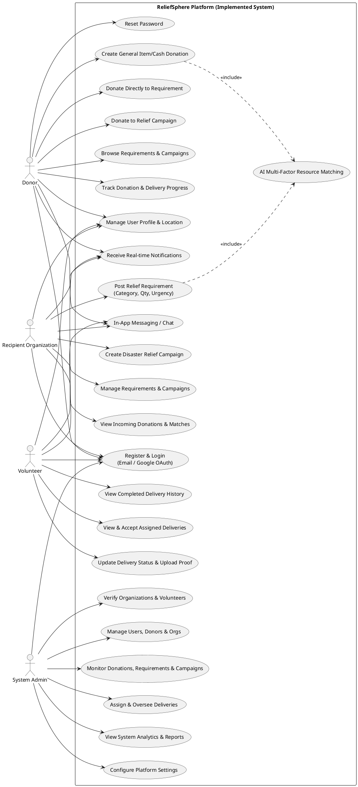
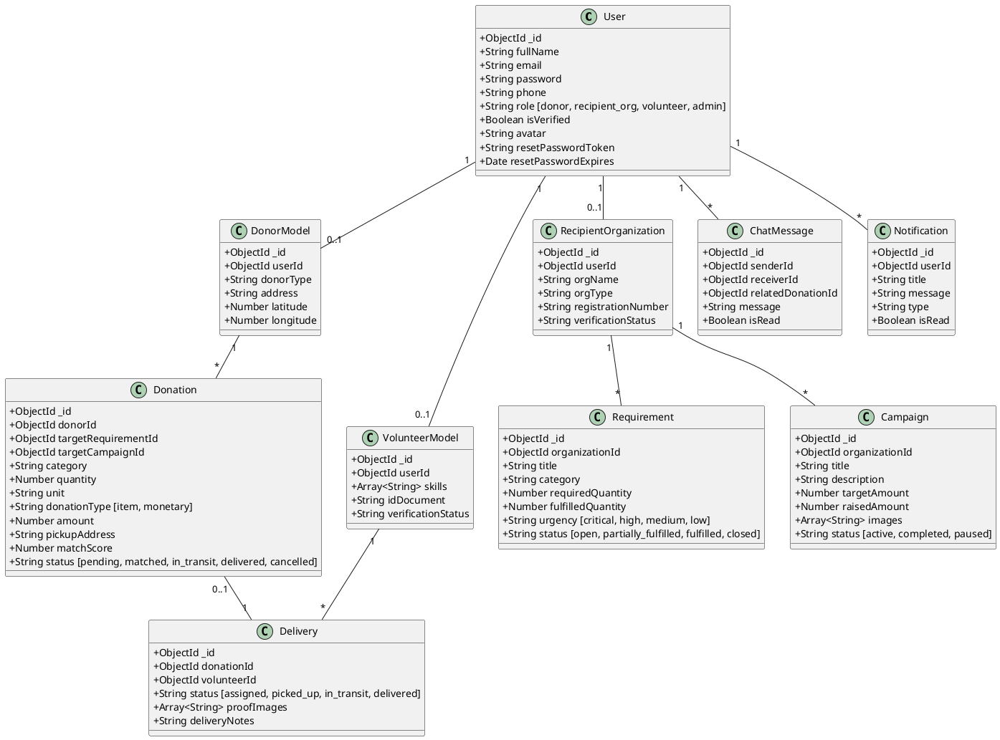
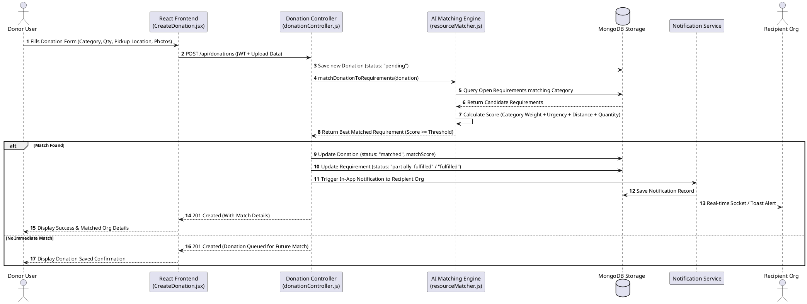
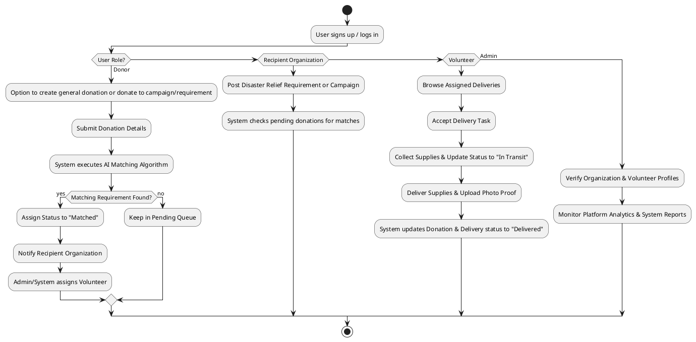
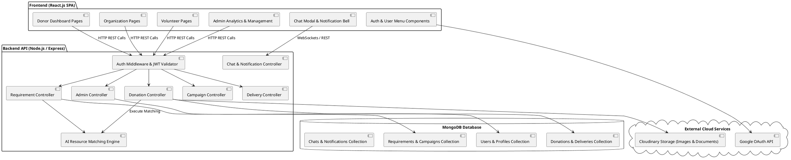
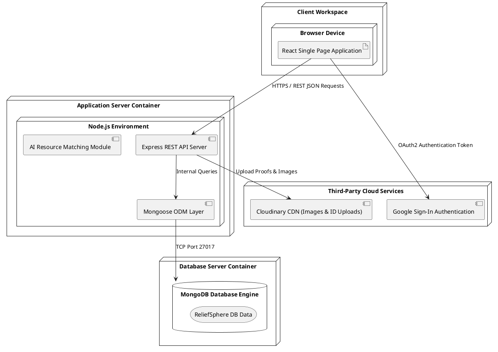

# Comprehensive PlantUML Diagrams for ReliefSphere

This document contains PlantUML code generated directly from the **currently implemented source code and features** of ReliefSphere.

---

## 1. Use Case Diagram (All Implemented Features)

---

## 2. Class Diagram (Reflecting Backend Mongoose Schemas & Controllers)

---

## 3. Sequence Diagram (Donation, AI Match Engine & Notification Flow)

---

## 4. Activity Diagram (End-to-End Relief Lifecycle)

---

## 5. Component Diagram (Full Architecture)

---

## 6. Deployment Diagram

